# ✂️ OpenCode Trim

[](https://www.npmjs.com/package/opencode-trim)
[](https://www.npmjs.com/package/opencode-trim)
[-10b981?logo=terminal&logoColor=white)](https://opencode.ai)
[](AUDIT.md)
[](AUDIT.md)
[](package.json)
[](LICENSE)

[Installation](#-installation) · [How Compression & Pruning Work](#-how-compression--pruning-work) · [24 Command Families](#-the-24-command-families) · [TUI Sidebar](#️-tui-sidebar-interface) · [Compaction Memory (FTS5)](#-optional-compaction-memory-phase-1--11--sqlite-fts5) · [Plugin Mesh Coordination](#-universal-plugin-mesh-coordination) · [Configuration](#️-configuration) · [Validation](#-validation--testing)

A high-performance, deterministic, silent-by-default **OpenCode V2** (`@opencode/plugin` `>=2.3.0`) tool-output compression, prompt-cache-aware context pruning, recoverable pruning vault, and optional FTS5 compaction-memory plugin for AI coding agents.

OpenCode Trim operates **100% standalone (`Solo`)** with zero runtime dependencies and automatically coordinates in any $2^N$ combination with **[OpenCode Guardian](https://github.com/huseyincig/opencode-guardian)**, **[OpenCode Smart Questions](https://github.com/huseyincig/opencode-smart-questions)**, **[OpenCode Hi](https://github.com/huseyincig/opencode-hi)**, and **[OpenCode Lazy Skill Engine](https://github.com/huseyincig/opencode-lazy-skill-engine)** via the Universal OpenCode V2 Plugin Mesh Bridge (`src/bridge.ts`).

---

## 📊 Verification & Live Acceptance

> OpenCode Trim **v0.8.1** was verified on **23 November 2026** against **OpenCode V2 (`>=2.3.0`)** on Node **26.13.1** and Bun **1.4.5**.

- **Current Automated Verification:** **508 / 508** unit, diagnostic-preservation, security, multi-location isolation, Universal Plugin Mesh interoperability, SQLite FTS5 memory, recoverable vault, and TUI view-model tests passing (`npm run check` — strict `tsc --noEmit`, `dist/` build, 94-file syntax check, 28 test suites).
- **Deterministic Compression & Pruning Benchmark (`npm run bench`):**
  - **24 Command Families:** `1,801,616 B` input → `2,483 B` output (`≈99.86%` reduction on the adversarial progress/noise corpus, `allChanged: true`, per-family median **0.04–0.20 ms** with RAM LRU memoization).
  - **Context Pruning:** `388 / 400` eligible historical tool results pruned (`757,266` characters / `≈252,422` estimated tokens reclaimed, median `≈7 ms`).
- **Packed Tarball & Dual-Runtime Verification:** `npm pack` `.tgz` artifact verified in isolated Node **26.13.1** and Bun **1.4.4** sandboxes across `.`, `./tui`, `./rpc`, `./core`, `./prune`, and `./pressure` entrypoints.
- **Live OpenCode V2 Host Acceptance:** Verified plugin load, `tool.execute.after` shell compression, `session.context` pruning, real-provider compression/pruning (`opencode-go/deepseek-v4.1-flash` and `opencode-go/beam-free`), SQLite FTS5 compaction archiving & `trim_history_search`, multi-location fail-closed isolation, and TUI sidebar rendering across 80–200 column widths.

Read the comprehensive [Audit & Production Acceptance Report](AUDIT.md) for reproduction commands, host evidence, and documented boundaries, and see the [0.8.1 release notes](CHANGELOG.md) for the latest changes.

---

## ✨ Key Highlights

- **Pure OpenCode V2 Architecture:** Built natively for **OpenCode V2** (`@opencode/plugin >=2.3.0`) with dedicated `.` (server), `./tui` (OpenTUI/Solid sidebar), `./rpc` (`opencode-trim-stats`), `./core`, `./prune`, and `./pressure` exports.
- **24 Deterministic Command-Family Compressors:** Purpose-built compressors for `git`, `npm`, `pnpm`, `bun`, `cargo`, `pytest`, `vitest`, `jest`, `tsc`, `eslint`, `biome`, `go`, `ruff`, `prettier`, `playwright`, `docker`, `kubectl`, `terraform`, `gradle`, `make`, `pip`, `uv`, `curl`, and `wget`.
- **Fail-Closed Diagnostic & Structured-Data Preservation:** Independently verifies that every error, warning, stack frame, exit notice, and summary line survives before accepting any candidate. Leaves JSON, JSONC, YAML, TOML, INI, CSV, TSV, XML, PEM, binary streams, mixed media, and Git diffs/patches (`diff`, `show`, `blame`, `apply`, `patch`, `format-patch`, `diff-tree`, `range-diff`, `am`, `request-pull`, `diff-index`, `diff-files`, `cherry-pick`, `log -p`, `stash show -p`, `show-branch -p`, `status -v`) byte-identical.
- **Prompt-Cache-Aware Context Pruning:** Retains per-session pruning decisions in memory and replays them byte-identically across turns so provider prompt caches are never churned on stable history. Admits new drops only on natural identity changes, force-band pressure (`>= 85%`), compaction-input passes, or absolute tool-char budget growth.
- **Evidence-Based Supersession:** Replaces earlier read-only tool outputs when superseded by an identical command/query or a wider `read` line range (`later.start <= earlier.start && later.end >= earlier.end`).
- **Instruction, Secret & Write Protection:** Never prunes user/assistant prose, system prompts, write/edit/patch/task/question/todo/permission/security/memory/MCP tools, failed or nonzero-exit tool runs, or instruction/secret files (`AGENTS.md`, `CLAUDE.md`, `GEMINI.md`, `PROTOCOL.md`, `SKILL.md`, `.env*`, `.pem`, `.key`, `.npmrc`, `.netrc`, `id_rsa`, `id_ed25519`, `id_ecdsa`, `id_dsa`, `secrets.json`).
- **Compact Guardian-Grade TUI Sidebar (`./tui`):** Opt-in (`tui.enabled: true`), borderless `sidebar.content` widget featuring `▶` / `▼` disclosure, two-column `StatRow` metrics, host-native context usage (`input + cache.read` over catalog limit), persisted compaction-history fallback after server restarts, and RPC-first probing with bounded hidden retries.
- **Optional SQLite FTS5 Compaction Memory (`memory.enabled: true`):** Default-off Phase 1 & 1.1 archive using Node 26 built-in `node:sqlite` + FTS5. Observes native compaction summaries, scrubs secrets fail-closed (`[REDACTED]`), enforces composite `UNIQUE(project, event_id)` isolation, and exposes section-aware `trim_history_search` (`codemode: false`).
- **Universal V2 Plugin Mesh Bridge (`src/bridge.ts`):** Zero-dependency N-way interoperability (`BRIDGE_REVISION: 2.3.1`) with sibling OpenCode V2 plugins: honors `isTrimMeshProtected` and cryptographic provenance tokens (`verifyMeshMetadata`), skips already-bounded outputs (`wasMeshBounded`), stamps `boundedBy: "opencode-trim"`, and cleans up session state on `session.deleted`.
- **Smart Context Cap, Token Calibration & Lossless Vault (`trim_expand`):** Supports `contextWindowCap` for 1M+ models, provider-reported token calibration, compaction-boundary cache reset, structural cleaners (`scrubBlobs`, `filterDebugLogs`, `collapseStackTraces`, `collapseTablePadding`, `collapseRepetitionLoops`) with bounded RAM LRU memoization, `pruneHistoricalReasoning`, `pruneUnrelatedDiagnostics`, `purgeErrorInputs`, `ToolDedupeRing`, and a secret-redacted SQLite `vault` (`trim_expand` with line-range & `grep` slicing).
- **Strict TypeScript & Zero Runtime Dependencies:** Pure strict TypeScript (`src/*.ts`, `src/tui.tsx`) compiled to `dist/*.js` + `.d.ts` targeting Node.js 26 Active LTS (`^26.0.0`) with zero external runtime dependencies.

---

## 📦 Installation

The current version is **0.8.1** (OpenCode **V2 `>=2.3.0`**, Node.js **`^26.0.0`**).

OpenCode Trim supports **Global**, **Project-Local**, **`.opencode/plugins/` Local Wrapper / Symlink**, **Local Development (`file://`)**, and **Remote TUI Client (`cli.json`)** installation modes.

> [!IMPORTANT]
> OpenCode V2 automatically discovers `./tui` and `./rpc` from `package.json` `exports` when loading `opencode-trim` — do **not** duplicate `"opencode-trim/tui"` in `opencode.json`.

### 1. 🌍 Global Installation (All Workspaces — Recommended)

To enable OpenCode Trim across **all** repositories and workspaces on your machine, add `opencode-trim@latest` to your global OpenCode configuration file (`~/.config/opencode/opencode.json`, `~/.config/opencode/opencode.jsonc`, `$XDG_CONFIG_HOME/opencode/opencode.json`, or `$OPENCODE_CONFIG_DIR/opencode.json`):

```json
{
  "$schema": "https://opencode.ai/config.json",
  "plugins": [
    "opencode-trim@latest"
  ]
}
```

Or pin an exact version and configure optional features (such as the TUI sidebar and FTS5 compaction memory):

```json
{
  "$schema": "https://opencode.ai/config.json",
  "plugins": [
    [
      "opencode-trim@0.8.1",
      {
        "maxTokens": "350k",
        "tui": {
          "enabled": true
        },
        "memory": {
          "enabled": true,
          "retentionDays": 90
        }
      }
    ]
  ]
}
```

You can also install the package globally via npm so it is cached offline across all environments:

```bash
npm install -g opencode-trim
```

### 2. 📁 Project-Local Installation (Single Repository / Team Setup)

To enable OpenCode Trim **only** for a specific repository, add `opencode-trim@latest` to `<project>/opencode.json` (or `<project>/.opencode/opencode.json`):

```json
{
  "$schema": "https://opencode.ai/config.json",
  "plugins": [
    "opencode-trim@latest"
  ]
}
```

Or install it into your project's `node_modules` via npm:

```bash
npm install -D opencode-trim
```

- **Strict Multi-Location Isolation:** When running on a shared multi-location OpenCode server, Trim canonicalizes workspace directories via `realpathSync` / `path.resolve` and filters events fail-closed so compaction archives, context after-fills, and TUI stats never leak across projects.

### 3. 🔗 `.opencode/plugins/` Directory or Symlink Installation (Monorepo & Air-Gapped)

If you manage plugins via OpenCode's `plugins/` directory (globally at `~/.config/opencode/plugins/opencode-trim` or project-locally at `<project>/.opencode/plugins/opencode-trim`):

1. Copy or symlink the repository into your OpenCode plugins directory:
   ```bash
   mkdir -p ~/.config/opencode/plugins
   ln -s /absolute/path/to/opencode-trim ~/.config/opencode/plugins/opencode-trim
   ```
2. Reference it in `~/.config/opencode/opencode.json` (note that relative `package` paths resolve relative to the **config directory**):
   ```json
   {
     "$schema": "https://opencode.ai/config.json",
     "plugins": [
       {
         "package": "./plugins/opencode-trim",
         "options": {
           "enabled": true,
           "shell": true,
           "toolFiltering": true,
           "pruning": true,
           "tui": { "enabled": true }
         }
       }
     ]
   }
   ```

### 4. 🧩 Package Exports & Entrypoints

OpenCode V2 automatically resolves the server and TUI entrypoints from `"opencode-trim"`, or you can import subpaths directly in custom hosts and scripts:

| Subpath | Export Target | Description |
| :--- | :--- | :--- |
| `opencode-trim` (`.`) | `./index.ts` | OpenCode V2 Promise server plugin (`id: "opencode-trim"`, `setup(ctx)`) |
| `opencode-trim/tui` | `./src/tui.tsx` | OpenCode V2 TUI sidebar plugin (`id: "opencode-trim.tui"`, `sidebar.content` slot) |
| `opencode-trim/rpc` | `./src/stats-rpc.ts` | Shared JSON-Schema RPC definition (`id: "opencode-trim-stats"`) |
| `opencode-trim/core` | `./src/compress.ts` | Standalone shell output compressor & 24 command-family dispatcher |
| `opencode-trim/prune` | `./src/prune.ts` | Standalone outgoing context pruner & supersession analyzer |
| `opencode-trim/pressure` | `./src/pressure.ts` | Model limit resolver & conservative token/pressure estimator |

### 5. 🛠️ Local Development (`file://` Source Checkout)

Clone the repository and load it directly via a `file://` URL in your global or project `opencode.json`:

```bash
git clone https://github.com/huseyincig/opencode-trim.git
cd opencode-trim
npm run check
```

```json
{
  "$schema": "https://opencode.ai/config.json",
  "plugins": [
    [
      "file:///absolute/path/to/opencode-trim",
      {
        "tui": { "enabled": true },
        "memory": { "enabled": true }
      }
    ]
  ]
}
```

### 6. 🖥️ Remote Server / Split TUI Client (`cli.json`)

For CLI-only remote-server connections where the OpenCode server runs on a remote host and your local terminal runs only the TUI client, configure `"opencode-trim/tui"` in `~/.config/opencode/cli.json`:

```json
{
  "plugins": [
    "opencode-trim/tui"
  ]
}
```

### Installation Scope & Storage Summary

| Mode / Feature | Config Location | Active Scope | Disk Persistence | Touches `<project>/.opencode/`? |
| :--- | :--- | :--- | :--- | :---: |
| **Default (Silent)** | Global or Project `opencode.json` | Configured workspace(s) | **None** (100% in-memory) | **No** |
| **TUI Sidebar (`tui.enabled: true`)** | `options.tui.enabled` | Per-location RPC & sidebar | Only boolean `expanded` in host UI storage | **No** |
| **Memory (`memory.enabled: true`)** | `options.memory.enabled` | Per-project isolated FTS5 rows | `$XDG_DATA_HOME/opencode-trim/memory.db` (`0600`) | **No** |

---

## ⚡ How Compression & Pruning Work

1. **Post-Execution Tool Hook (`ctx.tool.hook("execute.after")`)**:
   - Inspects completed `shell` / `bash` and list/search (`grep`, `glob`, `ls`, `list`, `find`) results.
   - If a sibling mesh plugin already bounded the output (`wasMeshBounded`), records the run in stats and skips re-compression.
   - Bypasses protected Git patch/diff commands, secret-viewing commands, structured payloads (JSON/YAML/TOML/INI/CSV/TSV/XML/PEM), binary streams, and mixed-media results.
   - Routes shell outputs through user `filterRules` and the **24 command-family compressors** (or generic consecutive-duplicate folding and passing-test compaction).
   - Verifies that every failure, warning, stack frame, exit notice, and summary line survived and at least `minSavingsRatio` (`15%`) was saved; stamps `metadata["opencode-mesh"].boundedBy = "opencode-trim"`.
2. **Outgoing Model Context Hook (`ctx.session.hook("context")`)**:
   - Pairs `tool-call` parts with `tool-result` parts in strict FIFO order per `callId`.
   - Protects mesh-stamped parts (`isTrimMeshProtected` with provenance token verification), failed/nonzero-exit results, write/edit/task/question/todo/security/MCP tools, instruction/secret files, structured/diagnostic outputs, the newest `protectRecentMessages` (`14`), a token-sized tail (`protectRecentTokens`, `4096` floor / `6%–25%` of usable window), and the newest `keepRecentToolResults` (`12`).
   - Replays committed per-session drops from `ContextCache` for prompt-cache stability, admitting new drops only when context pressure, range supersession, or the absolute tool-char budget authorizes reclamation.

---

## 🔄 Architecture & Turn Lifecycle

```mermaid
flowchart TD
    subgraph ToolHook["1. Post-Execution Tool Hook (tool.execute.after)"]
        TE["Completed tool result received"] --> MB{"Already mesh-bounded?"}
        MB -->|Yes| SkipMB["Record run in stats; skip re-compression"]
        MB -->|No| Kind{"Tool category?"}
        Kind -->|Shell / Bash| Guard{"Protected Git / Secret / Structured / Binary?"}
        Guard -->|Yes| KeepRaw["Preserve byte-identical output"]
        Guard -->|No| Fam["Dispatch 24 Command Families -> Generic Filter & Runner Compaction"]
        Kind -->|List / Search| Dedup["Fold consecutive identical lines only"]
        Fam --> Verify{"Diagnostics, summaries, exit notice & >=15% savings intact?"}
        Dedup --> Verify
        Verify -->|No| KeepRaw
        Verify -->|Yes| Stamp["Apply compressed output & stamp boundedBy='opencode-trim'"]
    end

    subgraph ContextHook["2. Outgoing Context Hook (session.context / session.compaction)"]
        CE["Outgoing model request"] --> Pair["Pair tool-call & tool-result in FIFO callId order"]
        Pair --> Filter["Exclude mesh-protected (provenance verified), errors, writes, instructions, diagnostics & live tail"]
        Filter --> Cache{"ContextCache admission (identity / >=85% force / supersession / size budget)?"}
        Cache -->|Deferred| Replay["Replay previously committed plannedDrops only"]
        Cache -->|Admitted| Select["Select superseded & oldest eligible results to meet target"]
        Replay --> Rewrite["Replace selected tool outputs with deterministic PRUNED placeholder"]
        Select --> Rewrite
    end
```



---

## 🧰 The 24 Command Families

Each command family removes only its own low-value progress chatter or passing-row noise while preserving diagnostics, warnings, file/line anchors, and final summaries:

| Category | Families | What Is Compressed | What Is Always Preserved |
| :--- | :--- | :--- | :--- |
| **Version Control** | `git` | Clone/fetch/push transfer progress (`Counting`, `Compressing`, `Receiving %`) | Status records, branch refs, commit log rows, all diffs/patches/blames |
| **JS / TS Package Managers** | `npm`, `pnpm`, `bun` | Registry download bars, `npm notice/sill/verb`, resolution spinners | Lifecycle errors, peer warnings, audit summaries, final `added N packages` |
| **Test Runners** | `vitest`, `jest`, `pytest`, `playwright`, `go` | Individual passing test rows (`✓`, `PASS`, `... ok`, dot progress) once summary is confirmed | Any failing test, assertion diff, stack trace, warning, or suite summary |
| **Compilers & Linters** | `tsc`, `eslint`, `biome`, `ruff`, `prettier` | Watch-mode clear-screen chatter, clean file check lines | Every compiler/lint code (`TS####`, `[EFW]###`), file:line:col anchor, and summary |
| **Rust & Native Builds** | `cargo`, `make`, `gradle` | `Compiling` / `Downloading` / `> Task UP-TO-DATE` / `Entering directory` chatter | Compiler warnings/errors, linker failures, `BUILD SUCCESSFUL/FAILED` |
| **Python Packaging** | `pip`, `uv` | `Downloading`, `Collecting`, progress bars, `Resolved/Prepared` lines | Dependency conflicts, build errors, `Successfully installed` summary |
| **Containers & Cloud** | `docker`, `kubectl`, `terraform` | Layer pull/extract progress, `Refreshing state...`, dot waits | Failed layers, pod errors, plan/apply changes, resource summaries |
| **Network Transfers** | `curl`, `wget` | Multi-line `% Total / % Received` and `[===>]` progress meters | HTTP headers, response bodies, TLS/connection errors, final transfer line |

---

## 🖥️ TUI Sidebar Interface

OpenCode Trim includes an optional V2 TUI extension (`./tui`) that mounts a borderless native-style section at the bottom of OpenCode's `sidebar.content` slot.

### 🔌 Enabling the TUI Sidebar

Because OpenCode V2 auto-discovers `./tui` from `package.json`, the sidebar uses server-side `tui.enabled: true` as its single opt-in and stays completely hidden (stopping background probes after bounded retries) when `tui.enabled` is `false`.

```json
{
  "$schema": "https://opencode.ai/config.json",
  "plugins": [
    [
      "opencode-trim@latest",
      {
        "tui": { "enabled": true }
      }
    ]
  ]
}
```

### 🔽 Collapsed View (Default)

```text
▶ Trim                     v0.8.1
Context              74% (740k/1M)
Savings           -106k | 12 drops
Memory                 4 summaries
```

- **Header:** Clickable disclosure header (`▶ Trim` / `▼ Trim`), current version (`v0.8.1`), and status marker (`!` when stale, `?` before first snapshot).
- **Context:** Host-native token usage (`input + cache.read` from the last assistant turn after any completed compaction) over the model catalog limit, falling back to Trim's `~`-prefixed estimate only when native usage is unavailable.
- **Savings:** Total characters saved across shell compression, list filtering, and context pruning (`Idle` when zero).
- **Memory:** Displayed in collapsed view only when the optional FTS5 memory store is active or reporting an error.

### 🔼 Expanded View (Click to Toggle)

Clicking the `▶ Trim` header expands the full operational breakdown:

```text
▼ Trim                     v0.8.1
Context
74%                      740k/1M
Optimization
shell             8 runs -64.2k
filter             3 runs -4.1k
prune           12 drops -37.7k
cache                    stable
Compaction
compact          2 auto / 1 manual
last                  14m ago auto
reduced         62%* ~410k -> 155k
Memory
4 summaries       3 searches | 37K
```

- **Zero-Noise Layout:** Optimization rows (`shell`, `filter`, `prune`, `cache`) appear only when activity is nonzero.
- **Restart-Resilient Compaction Fallback:** Live compaction counters are in-memory and reset on server restart; when live counters are unknown and no compaction is running, the TUI derives a read-only fallback (`compact N archived`, `failed N`, `last <age> ago <auto|manual>`) from persisted session compaction messages without making live-reduction claims.
- **Privacy-Safe RPC (`opencode-trim-stats`):** Snapshots carry only numeric counters and enum states — never file paths, commands, queries, prompt text, or model names.

---

## 🧠 Optional Compaction Memory (Phase 1 & 1.1 — SQLite FTS5)

When `memory.enabled: true` is configured, OpenCode Trim archives native compaction summaries into a local SQLite FTS5 database and exposes the `trim_history_search` tool (`codemode: false`).

- **Observe-Only Archiving:** Listens to `session.compaction.started`, `session.compaction.ended`, and `session.compaction.failed`. Never triggers compaction or synthesizes summaries.
- **Fail-Closed Multi-Location Isolation:** Collects canonical absolute locations from `event.location`, `event.data.location`, and `event.properties.location`; rejects absent, relative, ambiguous, conflicting, or foreign events before archiving.
- **Structured Secret Redaction:** Scrubs PEM blocks, `Bearer`/`Basic` tokens, JWTs, OpenAI/Anthropic/GitHub/GitLab/Slack/AWS/Google/npm keys, URL passwords, and nested secret-keyed JSON/env values (`[REDACTED]`). Unclosed or over-depth structured values fail closed through the end of the text.
- **Section-Aware FTS5 Search (`trim_history_search`):**
  - Parses canonical Markdown `##` headings (`objective`, `requirements`, `decisions`, `work_state`, `next_move`, `relevant_files`, `important_context`), tolerating case, spaces, hyphens, numbering, and colons while ignoring headings inside fenced code blocks.
  - Supports optional `section`, `sessionID`, `days` (recency window), `limit` (`1..20`), and `fullSection` (`2,400`-char expanded excerpt vs `400`-char snippet) filters.
  - Ranks matches by distinct query-term hits first, then newest within the same session, then BM25 rank and recency (scanning up to `1,000` rows / `8,000,000` chars inside a read transaction).
  - Enforces `agentAllowlist` and `agentDenylist` in `ctx.tool.hook("execute.before")`.
- **Recoverable Pruning Vault & Ref Discovery (`trim_expand`):**
  - Stores pruned tool outputs in a secret-redacted SQLite `vault` table (`maxVaultRows: 500` per project).
  - **Ref Discovery Mode:** Calling `trim_expand` without `id` lists recent cached refs (`id`, `tool`, `target`, `totalLines`, `date`, and `totalVaultRows` capacity) with optional `tool`, `target`, and `limit` filters so pruned outputs remain discoverable even after pruning notices leave active context.
  - **Slicing & Bounded Regex Grep:** Passing `id` (`"trm_..."`) restores the output with optional `startLine`, `endLine`, `grep`, `regex` (ReDoS-guarded), `caseSensitive`, and `maxChars` (default `12,000` chars) bounds.

---

## 🤝 Universal Plugin Mesh Coordination

OpenCode Trim includes the Universal OpenCode V2 Plugin Mesh Bridge (`src/bridge.ts`, `BRIDGE_REVISION: 2.3.1`, `Symbol.for("opencode.mesh.v2")`):

- **Publishes `context.prune`:** Registers `opencode-trim` in the directory-scoped mesh registry (`registerMeshPeer`) and unregisters cleanly on teardown.
- **Respects Protected Turns & Provenance (`isTrimMeshProtected`):** Never prunes tool outputs or synthetic remediation/handoff/task-contract/skill-injection turns protected by **[OpenCode Guardian](https://github.com/huseyincig/opencode-guardian)**, **[OpenCode Smart Questions](https://github.com/huseyincig/opencode-smart-questions)**, **[OpenCode Hi](https://github.com/huseyincig/opencode-hi)**, or **[OpenCode Lazy Skill Engine](https://github.com/huseyincig/opencode-lazy-skill-engine)**. Inspects all metadata holders (`part`, `part.result`, `part.state`, `part.payload`, `msg`) and verifies cryptographic provenance tokens (`verifyMeshMetadata`) against active session ledgers.
- **Bidirectional Output Bounding (`wasMeshBounded` / `boundedBy`):** Skips re-compressing tool results already bounded by a sibling plugin and stamps `metadata["opencode-mesh"].boundedBy = "opencode-trim"` on compressed results so downstream plugins never double-truncate.
- **Session Lifecycle Hygiene:** Excludes mesh-protected tool results from `ContextCache` absolute character budgets and invokes `forgetMeshSession(sessionID)` on `session.deleted`.

---

## ⚙️ Configuration

OpenCode Trim works **out of the box with zero configuration** (automatically capping 1M+ model context windows at **`350k` tokens** so sessions stay fast, focused, and cache-friendly).

### 🎯 Simple Screen-Matched Configuration (Recommended)

You only need to enter the exact **token count** (e.g. `"350k"` or `350000`) or **`% used`** (e.g. `"35%"`) you see on the OpenCode `Context` screen — no manual reserve or ratio math required:

```json
{
  "plugins": [
    {
      "package": "opencode-trim@latest",
      "options": {
        "maxTokens": "350k",
        "tui": { "enabled": true },
        "memory": { "enabled": true }
      }
    }
  ]
}
```

Or trigger by percentage of the model's context window (`"pruneAt": "35%"` or `"pruneAt": "350k"`):

| Simple Option | Default | Examples | What It Does |
| :--- | :---: | :--- | :--- |
| `maxTokens` | `"350k"` (`350000`) | `"350k"`, `"250k"`, `350000`, `0` | Direct target context ceiling matching the OpenCode `Context` token counter (`0` = uncapped model limit). |
| `pruneAt` | — | `"350k"`, `"35%"`, `35`, `0.35` | Direct threshold by token count (`"350k"`) or percentage of model window (`"35%"`). |
| `tui.enabled` | `false` | `true` / `false` | Show the compact `Trim` sidebar widget in the OpenCode TUI. |
| `memory.enabled` | `false` | `true` / `false` | Enable the SQLite FTS5 compaction archive (`trim_history_search`) and recoverable pruning vault (`trim_expand`). |

### 🔧 Advanced Engine Options (Optional)

All options are validated strictly at startup (unknown keys or out-of-range numbers throw immediately):

| Option | Default | Allowed Range / Type | Description |
| :--- | :---: | :---: | :--- |
| `enabled` | `true` | `boolean` | Master switch for the plugin. |
| `shell` | `true` | `boolean` | Compress eligible `shell` / `bash` outputs. |
| `toolFiltering` | `true` | `boolean` | Fold consecutive identical lines in `grep`, `glob`, `ls`, `list`, `find`. |
| `pruning` | `true` | `boolean` | Prune old, safe, completed tool outputs from outgoing model context. |
| `compactionInputPruning` | `false` | `boolean` | Also prune old tool outputs from native compaction request inputs. |
| `minOutputChars` | `1600` | `200..200000` | Minimum tool output length before compression runs. |
| `minSavingsRatio` | `0.15` | `0..0.9` | Minimum relative character reduction required to accept compression. |
| `maxOutputLines` | `160` | `20..2000` | Maximum lines allowed in a compressed shell output. |
| `maxOutputChars` | `16000` | `2000..1000000` | Maximum characters allowed in a compressed shell output. |
| `maxInputScanChars` | `2000000` | `10000..5000000` | Hard input scan ceiling; larger outputs pass through untouched. |
| `protectRecentMessages` | `14` | `4..100` | Number of newest messages protected from pruning. |
| `protectRecentTokens` | `4096` | `1024..64000` | Token tail protection floor (also at least `6%` of usable context, capped at `25%`). |
| `keepRecentToolResults` | `12` | `1..100` | Number of newest eligible tool results always kept unpruned. |
| `pruneAfterToolChars` | `100000` | `10000..2000000` | Absolute tool-result character budget when model pressure is unavailable. |
| `pruneMinResultChars` | `800` | `100..200000` | Minimum length of an individual tool result to be eligible for pruning. |
| `pruneEligibleTools` | `["shell", "bash", "read", "grep", "glob", "ls", "list", "search", "find", "webfetch"]` | Up to 40 tool names | Allowlist of core tool names eligible for read-only context pruning (generic read-only `<prefix>_search\|read\|grep\|glob\|list\|find\|zoom\|outline\|inspect\|view\|lookup\|symbols\|references\|definition\|callers\|callees\|imports\|tree\|stat` tools are also recognized automatically). |
| `pressureStartRatio` | `0.65` | `0.2..0.9` | Context usage ratio where pressure-based pruning begins. |
| `pressureForceRatio` | `0.85` | `0.5..0.98` | Context usage ratio that authorizes a prompt-cache bust (`allowNewDrops`). |
| `pressureCriticalRatio` | `0.94` | `0.7..0.999` | Critical context usage ratio for aggressive target reclamation. |
| `outputReserveTokens` | `8192` | `1024..100000` | Output token reserve subtracted from uncapped model context windows. |
| `contextWindow` | `0` | `0..10000000` | Explicit context window fallback for custom providers (`0` = disabled). |
| `contextWindowCap` | `350000` | `0..10000000` (or `"350k"`) | Default cap (`min(catalog, cap)`) on large 1M+ model windows (`0` = uncapped). |
| `supersessionMinChars` | `5000` | `100..200000` | Minimum superseded character mass required to trigger supersession pruning. |
| `purgeErrorInputs` | `true` | `boolean` | Blank oversized input arguments on stale failed tool calls outside the protected tail while keeping error outputs intact. |
| `pruneHistoricalReasoning` | `true` | `boolean` | Omit historical `reasoning` / `thinking` traces on assistant turns outside the protected tail while preserving current-turn reasoning and prose. |
| `pruneUnrelatedDiagnostics` | `true` | `boolean` | Filter `metadata.diagnostics` on completed `edit`, `write`, and `apply_patch` calls so only diagnostics for the edited file(s) are retained. |
| `prunePreviewLines` | `0` | `0..20` | Preserve `N` head and `N` tail preview lines around the pruning notice when the combined preview is significantly smaller than the original (`0` = notice only). |
| `dedupeWindow` | `0` | `0..32` | Same-session verified content-hash deduplication window for consecutive identical non-`read` tool outputs (`0` = disabled). |
| `filterRules` | `[]` | Up to 24 rules | Custom per-program `{ program, dropPrefixes, dropExact }` line filters. |
| `memory.enabled` | `false` | `boolean` | Enable the SQLite FTS5 compaction-summary archive (`trim_history_search`) and recoverable pruned-output vault (`trim_expand`). |
| `memory.dbPath` | `$XDG_DATA_HOME/opencode-trim/memory.db` | Absolute path or `":memory:"` | SQLite database file path (`0600` file, `0700` newly created directory). |
| `memory.retentionDays` | `90` | `1..3650` | Per-project retention window in days. |
| `memory.agentAllowlist` | `[]` | Up to 20 agent names | Optional allowlist for `trim_history_search` (empty = host permissions decide). |
| `memory.agentDenylist` | `[]` | Up to 20 agent names | Optional denylist for `trim_history_search` (denylist wins over allowlist). |
| `tui.enabled` | `false` | `boolean` | Enable the `opencode-trim-stats` RPC provider and TUI sidebar widget. |

---

## 🧪 Validation & Testing

Run the full verification suite locally:

```bash
npm run check     # Strict tsc --noEmit, dist/ build, 94-file syntax check + 500 tests
npm test          # Node.js test runner (500 tests across 28 suites)
npm run bench     # Deterministic 24-family compression & 800-message pruning benchmark
npm run pack:dry  # Verify packed npm tarball contents (147 files)
```

---

## 🏗️ Project Layout

- `index.ts`: OpenCode V2 Promise server plugin entrypoint (`id: "opencode-trim"`, `setup: setupTrim`).
- `src/plugin.ts`: V2 hook orchestrator (`tool.execute.after`, `session.context`, `session.compaction`, `opencode-trim-stats` RPC, mesh peer lifecycle).
- `src/compress.ts`: Shell output compression pipeline, structured/binary guards, program resolver, and diagnostic preservation verifier.
- `src/families/*`: 24 deterministic command-family compressors and shared `util.ts` helpers.
- `src/prune.ts`: Call-ID FIFO context pruner, range-aware `read` supersession, instruction/secret guards, and `isTrimMeshProtected`.
- `src/cache.ts`: Prompt-cache-aware per-session drop replay (`ContextCache`) and absolute tool-char budget gate.
- `src/pressure.ts`: Model catalog limit discovery and conservative UTF-8 byte/3 token estimator.
- `src/diagnostics.ts`, `src/filters.ts`, `src/git.ts`, `src/runners.ts`: Linear-time diagnostic predicates, declarative line filters, quote-aware Git patch inspector, and test-runner progress compactor.
- `src/memory.ts`, `src/memory-store.ts`, `src/memory-sections.ts`: Optional Node 26 `node:sqlite` FTS5 compaction-summary archive, fail-closed secret redactor, section parser, and `trim_history_search` / `trim_expand` tools.
- `src/tui.tsx`, `src/tui-model.ts`, `src/tui-format.ts`, `src/stats.ts`, `src/stats-rpc.ts`: Optional OpenTUI/Solid sidebar widget, pure view-model, and location-scoped stats RPC.
- `src/bridge.ts`: Universal OpenCode V2 Plugin Mesh bridge (`BRIDGE_REVISION: 2.3.1`).

---

## 📄 License

MIT © [Hüseyin Hadi Çığ](https://github.com/huseyincig) — see [LICENSE](LICENSE).
